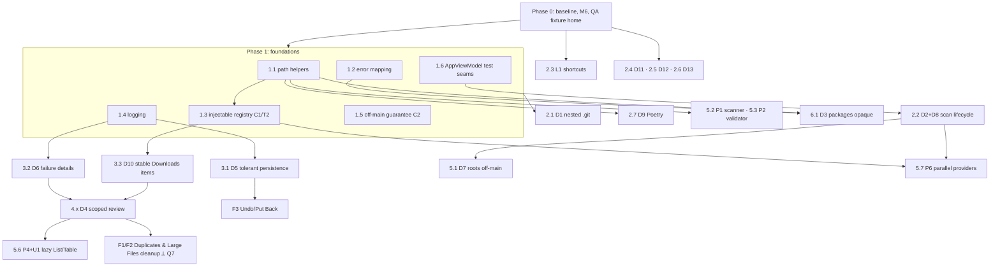

# DiskSweep — Implementation Plan

This plan puts the findings in [improvements.md](improvements.md) into phases, ordered by dependency. Finding IDs (D1, L2, P3, …) refer to that document. Nothing in this plan has been implemented yet.

**Baseline:** `main` at `b8606cd` · macOS 15.0 deployment target · Swift 6 language mode · Xcode 27.3 · XcodeGen installed at `/opt/homebrew/bin/xcodegen`.

---

## 1. How to use this plan

### Ground rules

1. **One branch and one PR per work item.** Small items within the same phase can share a PR when they touch different files. Branch from `main` and use names such as `fix/d1-derived-data-nested-git`.
2. **Never test cleanup against real user data.** Every change that can delete files gets a unit test that uses a temporary directory. Manual QA uses the debug fixture home from item 0.3, never your real home folder.
3. **Safety-critical files need extra review.** Changes to `SafetyValidator.swift`, `CleanupEngine.swift`, `FileSystemScanner.swift`, `ProviderSupport.swift`, or any `*Rules` type need these steps:
   - All existing tests in `SafetyValidatorTests`, `CleanupEngineTests`, `DeveloperCleanupProvidersTests`, `ProjectArtifactsProviderTests`, and `SafetyScannerTests` pass.
   - At least one new negative test proves the change doesn't widen deletion scope beyond what was intended.
   - Read the diff line by line before merging.
4. **New source files must be added to the Xcode project.** `project.yml` is the source of truth. After adding or removing a file, run `xcodegen generate` and commit the resulting `DiskSweep.xcodeproj` changes. This is why item 0.2 must be done first.
5. **Update the README in the same PR** when user-visible behavior, shortcuts, or safety rules change.

### Standard verification (every PR)

```bash
xcodebuild -project DiskSweep.xcodeproj -scheme DiskSweep -destination 'platform=macOS' build
```

```bash
xcodebuild -project DiskSweep.xcodeproj -scheme DiskSweep -destination 'platform=macOS' test
```

- The build has zero new warnings. Swift 6 strict-concurrency diagnostics count as errors.
- All tests pass, and the new tests named in the work item exist and pass.
- The item's manual check is done against the fixture home (0.3).

### Rough size

| Phase | Theme | Effort | Can start after |
| --- | --- | --- | --- |
| 0 | Baseline, project hygiene, QA setup | 0.5–1 day | — |
| 1 | Shared foundations (no behavior change) | 1.5–2 days | 0 |
| 2 | Critical correctness fixes | 2 days | 1 (items 2.4–2.6 only need 0) |
| 3 | Data integrity and transparency | 1.5 days | 1 |
| 4 | Selection scoping and review sheet | 1.5–2 days | 3.3 |
| 5 | Performance and list accessibility | 2–3 days | 1, 4 |
| 6 | Analyzer accuracy and policy | 2 days | 1 (6.5 needs decision Q2) |
| 7 | Maintainability and polish | 1–1.5 days | 2–6 |
| 8 | Features (optional, separate PRs) | varies | 2–4, 3.1 |

---

## 2. Decisions needed before or during implementation

These are product or policy choices the plan can't settle. Each has a recommended default. Items that depend on a decision are marked **⟂ Q#**.

| # | Decision | Recommended default | Blocks |
| --- | --- | --- | --- |
| Q1 | Where does the signing team ID (`7RLDYXQTNX`) live? It is currently only in the uncommitted `.pbxproj`. | A `Config/Local.xcconfig` that isn't committed, referenced from `project.yml`, plus a committed `Local.xcconfig.example` | 0.2 |
| Q2 | Should identity checks be relaxed for `.safe` cache locations, so active app caches can be cleaned (L2)? | Yes: match device, inode, and kind for `.safe` locations, and keep strict matching everywhere else | 6.5 |
| Q3 | Which items does a screen's "Review" include (D4)? | Exactly what that screen's footer counted: the locations shown on that screen, or only Downloads | 4.1 |
| Q4 | What happens to selected Downloads files that a filter or search hides (D4)? | Review includes only visible selected files, and the footer says "N selected files hidden by filters" | 4.2 |
| Q5 | Can bundles found in Downloads (`.app`, `.sparsebundle`) be cleaned, or only shown (D3)? | Show them in 6.1. Cleaning them, Trash only, comes later as part of F1/F2. | 6.1 |
| Q6 | Which shortcuts should replace the bare-key ones (L1)? | ⌘Y Quick Look, ⌘. Cancel Scan, and Space only inside lists and tables | 2.3 |
| Q7 | How should Duplicates and Large Files cleanup be authorized? The allowlist doesn't cover arbitrary home-folder files and refuses Documents and Desktop. | Needs a design spike (see F1). Don't widen the allowlist without one. | F1, F2 |
| Q8 | Merge Large Folders and Disk Usage into one screen (M3)? | Yes, one screen with "List" and "Map" modes | 7.2 |

---

## 3. Dependency graph



**Critical path:** 0 → 1.3 / 1.6 → 2.2 → 3.3 → 4.1 → 5.6. Phase 2's small fixes (2.4–2.6) can land at any time after Phase 0, in parallel.

---

## Phase 0 — Baseline, project hygiene, QA setup

**Goal:** a reproducible green baseline, a project file that survives `xcodegen generate`, and a safe way to run the app against fake data.

### 0.1 Record the baseline
- **Changes:** none. Run the standard build and test commands on `main`, then record the test count and duration in the PR description of 0.2.
- **Verification:** the build succeeds and every test passes. If anything fails on `main`, fix or quarantine it in its own PR before starting Phase 1.
- **Risk:** the README's "61 tests" figure is out of date (provider and artifact tests were added since). Note the real number.

### 0.2 Resolve project-file drift (M6) ⟂ Q1
- **Files:** `project.yml`, new `Config/Local.xcconfig.example`, `.gitignore`, `DiskSweep.xcodeproj/project.pbxproj` (regenerated), `DiskSweep.xcodeproj/xcshareddata/xcschemes/DiskSweep.xcscheme` (regenerated).
- **Changes:**
  - Move `DEVELOPMENT_TEAM` into `Local.xcconfig`, which is gitignored, and point `project.yml` at it with `configFiles`.
  - Add `ASSETCATALOG_COMPILER_GENERATE_SWIFT_ASSET_SYMBOL_EXTENSIONS` and `STRING_CATALOG_GENERATE_SYMBOLS` to `project.yml` if you want to keep them.
  - Decide whether the test target should carry `CODE_SIGN_IDENTITY` / `CODE_SIGN_STYLE` while `CODE_SIGNING_ALLOWED = NO`. It doesn't need them.
  - Run `xcodegen generate`.
- **Verification:** running `xcodegen generate` again produces no diff. The standard build and test pass. Opening the project in Xcode shows the expected team.
- **Risks:** XcodeGen and Xcode 27 can disagree on `objectVersion` or the scheme format version. The pending diff already shows scheme `version` 1.7 → 1.3. Accept whatever XcodeGen produces, but check that the scheme still has `codeCoverageEnabled` and the test target.

### 0.3 Debug-only fixture home for manual QA
- **Files:** `DiskSweep/App/DiskSweepApp.swift`, new `scripts/make-fixture-home.sh`.
- **Changes:**
  - Under `#if DEBUG`, read a `-DiskSweepHomeOverride <path>` launch argument and pass it to `AppViewModel(homeDirectory:)`, plus matching `SettingsStore` and `CleanupHistoryStore` instances that use a separate `UserDefaults` suite and history file under the fixture folder.
  - The script builds a fake home under the scratch or temp directory with:
    - DerivedData that has a Swift package checkout containing `.git`
    - a `pypoetry/virtualenvs` folder
    - Downloads with `.dmg`, `.app`, and `.sparsebundle` items
    - a `VM.utm` bundle
    - duplicates and hard links
    - an old JetBrains version folder
- **Verification:** with the argument set (Scheme → Run → Arguments), Overview shows only fixture data. A Release build ignores the argument; check that the string doesn't appear in the binary (`strings`).
- **Risks:**
  - The override must not leak into Release. Keep it entirely inside `#if DEBUG`.
  - `SafetyValidator` and providers default to `FileManager.default.homeDirectoryForCurrentUser` in several places, such as `TemporaryFilesProvider`, the `PermissionManager` defaults, and `ProjectArtifactsProvider.refusalReason(for:)` when called from `SettingsView`. Inventory those call sites and either thread the home folder through or accept that they still point at the real home.
  - This is also the main reason the fixture must never contain anything you would mind losing.

### 0.4 Runtime confirmation of the "likely" findings
- **Changes:** none. Run the manual checks against the fixture home:
  - **L1:** type "my file" in the Downloads search field, then press Esc in an empty search field.
  - **L2:** confirm with a unit-style experiment. In a temp directory, scan, add a child file to a scanned cache folder, then clean. Expect `targetChanged`.
  - **L3:** read the capacity keys before and after deleting a large file in `/tmp`.
- **Output:** a confirmed or rejected result for each, added to the PR description of 2.3, 6.4, and 6.5. A rejected L1 drops item 2.3.

**Phase 0 exit criteria:** the baseline is green, the project regenerates cleanly, and a fixture home is available.

---

## Phase 1 — Shared foundations (no intended behavior change)

**Goal:** remove duplication and add test seams so later fixes are small and testable. Every item here should leave all existing tests green **without editing them**, except mechanical changes to how the registry is injected.

### 1.1 Consolidate path-containment helpers (M1, part 1)
- **New file:** `DiskSweep/Services/URL+Containment.swift`, with these functions:
  - `func isSameOrDescendant(of root: URL) -> Bool`
  - `func isStrictDescendant(of root: URL) -> Bool`
  - `func isSameOrDescendantIgnoringCase(of root: URL) -> Bool`
  - All three compare standardized `pathComponents`.
- **Replace these private copies:**
  - `FileSystemScanner.swift:318`
  - `SafetyValidator.swift:592` and `:599`
  - `ProjectArtifactsProvider.swift:513` and `:520`
  - `CleanupEngine.swift:292`
  - `AppViewModel.swift:466` (`isStrictAncestor` is the reverse relation)
  - `AnalyzerFileSystem.swift:360` (`contains`), which is a string-prefix comparison
- **Verification:**
  - New `URLContainmentTests` with a table of cases: the same path, a child, a sibling with a shared prefix (`/a/bc` vs `/a/b`), a trailing slash, the root `/`, a case difference, and `..` (after standardization).
  - Before deleting the `AnalyzerFileSystem.contains` string version, assert in the test that it and the new helper agree on every case. Otherwise, document the intentional difference: the string version treats `/a/b/` and `/a/b` the same, and so does the component version.
- **Risk (safety-critical):** a subtle semantic change in containment can widen or narrow deletion scope. Mitigate by converting one call site per commit, so the diff is easy to bisect.

### 1.2 Unify error → `ScanIssue` mapping (M1, part 2)
- **Files:** `DiskSweep/Models/ScanModels.swift` (add `ScanIssue.init(error:at:)`), `FileSystemScanner.swift:325-343`, `AnalyzerFileSystem.swift:266-304`, and their call sites.
- **Changes:** keep the superset of both mappings. That means the Cocoa codes from both, plus the POSIX domain (`EACCES`/`EPERM` → `.permissionDenied`, `ENOENT` → `.disappeared`, `EIO` → `.inputOutput`), plus `SafetyValidationError` → `.inaccessible`.
- **Verification:** a new `ScanIssueMappingTests` table test. Existing tests stay green.
- **Risk:** low. UI text doesn't depend on `kind` today.

### 1.3 Injectable, lock-free snapshot registry (C1, T2)
- **Files:**
  - `DiskSweep/Services/CleanupSnapshotRegistry.swift`
  - `DiskSweep/Models/ScanModels.swift` (`ScanContext`)
  - `DiskSweep/Services/CleanupEngine.swift`
  - Every file that uses `.shared`: `AnalyzerFileSystem.swift` (1), `DownloadsAnalyzer.swift` (1), `CleanupEngine.swift` (3), `DownloadsProvider.swift` (2), `LogProvider.swift` (5), `ProjectArtifactsProvider.swift` (4), `ProviderSupport.swift` (4), `TemporaryFilesProvider.swift` (3), `XcodeCleanupProviders.swift` (5), `CleanupEngineTests.swift` (1)
  - `AppViewModel.swift`
- **Changes:**
  - Make the registry `final class CleanupSnapshotRegistry: Sendable` holding `private let state = Mutex<[String: [UUID: CleanupScanSnapshot]]>([:])` (`import Synchronization`, available on macOS 15). Drop `@unchecked`.
  - Make `init()` internal, and keep `static let shared` only as the app's default instance.
  - Add `let snapshots: CleanupSnapshotRegistry` to `ScanContext` (default `.shared`) and to `CleanupEngine.init` (default `.shared`).
  - Providers and analyzers use `context.snapshots`. `DownloadsProvider.cleanupItem(for:)` takes the registry as a parameter.
  - `AppViewModel` creates one registry and passes it both to `makeScanContext()` and to the engine.
- **Verification:**
  - The existing suite passes.
  - New `CleanupSnapshotRegistryTests`: concurrent `record`/`snapshot`/`remove` from a `TaskGroup` of 1,000 tasks has no lost writes, and `remove` deletes empty provider buckets.
  - Tests switch to fresh registries, so turning on `parallelizable = "YES"` for one local run doesn't produce cross-test failures. You don't have to commit that setting.
- **Risks:**
  - `Mutex` is `~Copyable`. Keep it as a stored `let` in a class, never in a struct that gets copied.
  - If a provider ends up using a different registry instance from the engine, every cleanup fails with "scan-time identity unavailable". Add an engine test that scans with registry A and cleans with registry B, and expects that refusal, to prove the wiring is explicit.

### 1.4 Logging infrastructure (D6, part 1)
- **New file:** `DiskSweep/Services/Log.swift`, defining `enum Log { static let scan = Logger(subsystem: "com.disksweep.DiskSweep", category: "scan"); cleanup; persistence }`.
- **Call sites:**
  - Every `failures.append` in `CleanupEngine.clean`
  - Root preflight refusals in `ProviderSupport` and providers
  - Persistence failures in `CleanupHistoryStore.persist`/`reload` and `SettingsStore.saveUnlessRestoring`/`init`
- **Rules:** log paths with `privacy: .private`, and reasons and categories as `.public`. Never log file contents.
- **Verification:** run a fixture cleanup that triggers a refusal, then run `log stream --predicate 'subsystem == "com.disksweep.DiskSweep"' --level debug` and check that the entries appear with redacted paths when you aren't attached to the debugger.
- **Risk:** only privacy. Review each interpolation.

### 1.5 Make "providers run off the main actor" explicit (C2)
- **Files:** `DiskSweep/Services/CleanupProvider.swift` and all provider `scan` implementations, or one wrapper in `AppViewModel`.
- **Changes:**
  - Preferred: annotate the protocol requirement and its implementations with `@concurrent` (Swift 6.2 compiler, no OS requirement).
  - Alternative with fewer files: in `AppViewModel.startCleanupScan`, run each `provider.scan` inside `Task.detached(priority: .utility)` and forward cancellation, matching the analyzers' pattern.
  - Add `dispatchPrecondition(condition: .notOnQueue(.main))` at the top of `ProviderSupport.scanChildren` and `scanDirectoryCandidates`, inside `#if DEBUG`.
- **Verification:** the Debug test suite passes with the preconditions in place. As an experiment, turn on `SWIFT_UPCOMING_FEATURE_NONISOLATED_NONSENDING_BY_DEFAULT = YES` and confirm the preconditions still hold. Don't commit that flag unless you mean to adopt it.
- **Risk:** low. `@concurrent` requires the callee to be `nonisolated`, which providers already are.

### 1.6 `AppViewModel` test seams (prerequisite for T1)
- **Files:** `DiskSweep/ViewModels/AppViewModel.swift`, new `DiskSweepTests/AppViewModelTests.swift`, new `DiskSweepTests/Fakes/FakeCleanupProvider.swift`.
- **Changes:**
  - Add an init parameter `standardProviders: [any CleanupProvider]? = nil` (nil means `StandardCleanupProviders.all`) and `registry` (from 1.3).
  - Inject `SettingsStore(userDefaults: UserDefaults(suiteName: UUID().uuidString)!)` and a temp-file `CleanupHistoryStore` in tests.
  - `FakeCleanupProvider` has a configurable delay and item list, and an option to ignore cancellation for N milliseconds, which is needed to reproduce D2.
- **Verification:** a smoke test runs a full scan with two fake providers and asserts `categories.count == 2` and that `.safe` items are preselected.
- **Risk:** `@MainActor` test classes plus `await` on `Task` completion. Expose `cleanupScanTask` through an internal `waitForScan()` helper that only tests use (internal is enough because of `@testable import`).

**Phase 1 exit criteria:** no user-visible behavior change, all tests green, and the new seams and tests are merged.

---

## Phase 2 — Critical correctness fixes

### 2.1 Nested `.git` in DerivedData and tool caches (D1)
- **Depends on:** 1.1, 1.3.
- **Files:**
  - `DiskSweep/Models/CleanupLocation.swift`
  - `DiskSweep/Services/Providers/ProviderSupport.swift` (`scanChildren`)
  - `DiskSweep/Services/CleanupEngine.swift:248-254`
  - `DiskSweep/Services/Providers/ProjectArtifactsProvider.swift:40`
  - `DiskSweep/Services/Providers/StaleIDEVersionsProvider.swift:23`
  - `README.md` (safety section)
- **Changes:**
  1. Add `var permittedNestedNames: Set<String>` to `CleanupLocation`:
     - `.xcodeDerivedData` → `[".git"]`
     - `.developerToolCaches` → `[".git"]`
     - `.projectArtifacts` → `["node_modules"]`
     - `.staleIDEVersions` → `["node_modules", ".git"]`
     - every other location → `[]`
  2. Make `ProjectArtifactRules.permittedNestedNames` and `StaleIDEVersionRules.permittedNestedNames` refer to the location property, so there is one source of truth.
  3. In `ProviderSupport.scanChildren`, pass `excludedNames: FileSystemSafetyPolicy.excludedNames.subtracting(location.permittedNestedNames)` to `sizer.size`.
  4. Make `CleanupEngine.permittedNestedNames(for:)` return `location.permittedNestedNames`.
- **Verification (new tests in `DeveloperCleanupProvidersTests`):**
  - **Positive:** `DerivedData/App-x/SourcePackages/checkouts/Pkg/.git/HEAD` → the item is `isDeletable`, and the engine removes it.
  - **Positive:** `.cargo/git/checkouts/foo-1/abc/.git/HEAD` → deletable and removable.
  - **Negative:** `Library/Caches/com.example/.git/HEAD` under User Caches stays non-deletable, and the engine refuses it.
  - **Negative:** a DerivedData child containing `node_modules` stays refused.
  - **Manual:** in the fixture home, the DerivedData item's checkbox is enabled, and Clean succeeds.
- **Risks:**
  - This widens what can be deleted. The roots themselves are unchanged and still validated by `isExpectedRoot`.
  - A user could put a real repository inside `~/.cargo/git/checkouts`, though that is unlikely. Tool caches are `.safe` and preselected, so consider `.reviewRecommended` for the Cargo Git checkouts entry. It already has its own label.

### 2.2 Scan and analysis lifecycle (D2, D8)
- **Depends on:** 1.6.
- **Files:** `DiskSweep/ViewModels/AppViewModel.swift`, `DiskSweep/App/DiskSweepCommands.swift`, `DiskSweep/Views/RootView.swift:17-28`.
- **Changes:**
  1. Add `@ObservationIgnored private var scanGeneration = 0` and `analysisGeneration = 0`.
  2. `startCleanupScan` increments the generation and captures it. After every `await`, the task checks `generation == scanGeneration` before mutating state, and its tail clears `cleanupScanTask` and progress only when the generations still match.
  3. `cancelCleanupScan`: `guard let task = cleanupScanTask else { return }`, cancel it, increment `scanGeneration` (which invalidates the old task), then clear the UI state and set `lastScanWasCancelled = true`.
  4. Make the same changes to `beginAnalysis` and `cancelAnalysis`.
  5. Add `let isScanning: Bool` to `DiskSweepCommandActions`. "Cancel Scan" becomes `.disabled(!(actions?.isScanning ?? false))`, and "Scan" is disabled while scanning. Remove the duplicate "Rescan" item (M2), or make it ⇧⌘R that clears results first.
- **Verification (new `AppViewModelTests`):**
  - Start a scan with a slow provider that ignores cancellation, cancel, then start again immediately. After both tasks finish: `isCleanupScanning` was `true` until the second scan finished, `categories` has no duplicate locations, and progress was not cleared early.
  - Call `cancelCleanupScan()` while idle after a completed scan, and assert `lastScanWasCancelled == false`.
  - Start analysis A, then start analysis B. B's `analysisActivity` stays set until B finishes, and A's results aren't written.
  - **Manual:** press Esc after a completed scan in the fixture home. The Overview label stays "Your scan is ready".
- **Risks:**
  - A missed generation check after an `await` reintroduces the race. Review every `await` in the task body (`provider.scan`, `refreshDiskStatistics`).
  - Snapshots from a cancelled provider can still race the registry (improvements.md D2, last bullet). The safe failure is acceptable. 5.7 removes it for parallel scans by giving each scan its own registry entry or key.

### 2.3 Replace bare-key menu shortcuts (L1) ⟂ Q6
- **Depends on:** 0.4 confirming L1, and 2.2 (both edit `DiskSweepCommands.swift`).
- **Files:** `DiskSweep/App/DiskSweepCommands.swift:36-37,48-49`, `DiskSweep/Views/Analyze/LargeFilesView.swift`, `README.md`.
- **Changes:**
  - Quick Look → ⌘Y. Cancel Scan → ⌘. (`.keyboardShortcut(".", modifiers: .command)`).
  - In `LargeFilesView`'s `Table`, add `.onKeyPress(.space) { quickLook(selected); return .handled }`. 5.6 adds the same for the other lists.
- **Verification (manual, fixture home):** spaces type normally in every toolbar search field, Esc clears the search field, ⌘Y opens Quick Look for the selected Large File, and Space in the table opens Quick Look.
- **Risk:** low. Users who learned Space lose it outside tables until 5.6 lands.

### 2.4 Large Files threshold units (D11)
- **Depends on:** Phase 0 only.
- **Files:** `DiskSweep/Services/Analyzers/LargeFileAnalyzer.swift:17`, `DiskSweep/Views/Analyze/LargeFilesView.swift:25-33,71-89`.
- **Changes:**
  - Set `defaultThreshold = 100_000_000`, matching the decimal units `ByteCountFormatter` uses with `.file` style.
  - Initialize `customThresholdMB` from `threshold` in `.onAppear` when the threshold isn't one of the presets.
  - Make the Custom tag stable, for example a sentinel or an `enum ThresholdChoice`, so selecting "Custom" doesn't jump to 250 MB without the user asking.
- **Verification:**
  - Update `AnalyzerLargeFileAndFolderTests` if any test depends on 104,857,600.
  - **Manual:** on first open the picker shows "> 100 MB", no stepper appears, and the console has no "Picker selection is invalid" warning.
- **Risk:** tiny. Files between 100.0 and 104.9 MB now appear.

### 2.5 Hard-link representative (D12)
- **Depends on:** Phase 0 only.
- **Files:** `DiskSweep/Services/Analyzers/DuplicateAnalyzer.swift:293-322`.
- **Changes:** group by `PhysicalFileIdentity`, keep the shallowest path in each group (using the same ordering as `preferredKeeper`), and count the rest in `hardLinkAliasesIgnored`. Optionally switch `physicalIdentity` to `SafetyValidator.captureIdentity`, which uses `lstat` and doesn't follow symlinks, for consistency.
- **Verification (`DuplicateAnalyzerTests`):**
  - New test: `A` plus its hard link `A'`, plus a copy `B` → one group `{A, B}` (or `{A', B}`), with `hardLinkAliasesIgnored == 1`.
  - The existing `testHardLinkAliasesAreNotReportedAsReclaimableDuplicates` still passes, since a lone hard-link pair still produces no group.
- **Risk:** low.

### 2.6 Trash-first default disposition (D13)
- **Depends on:** Phase 0 only. Coordinate with 4.3, which edits the same sheet.
- **Files:** `DiskSweep/Views/Cleanup/CleanupReviewView.swift:11-21`.
- **Changes:** set the initial `userFileDisposition` to `.trash` when `includesTrashFirstFolders` is true. Otherwise use `preferredUserFileDisposition`.
- **Verification:** a unit test on a small pure helper, `CleanupReviewModel.initialDisposition(items:preference:)`, extracted for this purpose. **Manual:** with "Prefer Move to Trash" off, select a project artifact, and the sheet opens on "Move to Trash".
- **Risk:** none.

### 2.7 Poetry virtual environments (D9)
- **Depends on:** 1.1.
- **Files:** `DiskSweep/Services/Providers/UserCacheProvider.swift:28-32`, `DiskSweep/Services/Providers/DeveloperToolCacheProvider.swift:3-55`, `README.md`.
- **Changes:**
  - Add `"pypoetry"` to the User Caches `excludedChildNames`.
  - Add `CacheDirectory("Library/Caches/pypoetry/cache", tool: "Poetry")` and `CacheDirectory("Library/Caches/pypoetry/artifacts", tool: "Poetry", label: "Poetry artifacts")`.
  - Never add `virtualenvs`.
  - Update the provider's header comment, which currently says caches inside `~/Library/Caches` are left to User Caches.
- **Verification:**
  - New test: a fixture with `pypoetry/{cache,artifacts,virtualenvs}`. User Caches offers no Poetry item. Package Manager Caches offers children of `cache` and `artifacts` only. The engine refuses `pypoetry/virtualenvs/x` under every authorization.
  - `SafetyValidatorTests.testEveryStandardProviderUsesAnAcceptedRootShape` still passes, because the new roots are accepted through `DeveloperToolCacheProvider.cacheDirectories`.
- **Risk:** `removeProviderOverlaps` already drops a User Caches item that contains another provider's root. Both mechanisms now agree. Confirm no other `~/Library/Caches` child is hidden by accident.

**Phase 2 exit criteria:** DerivedData of Swift-package projects can be cleaned in the fixture home, and the scan and analysis lifecycle tests pass.

---

## Phase 3 — Data integrity and transparency

### 3.1 Tolerant, non-destructive persistence (D5)
- **Depends on:** 1.4.
- **Files:**
  - `DiskSweep/Models/CleanupResult.swift:125-150`
  - `DiskSweep/Services/CleanupHistoryStore.swift`
  - `DiskSweep/Services/SettingsStore.swift`
  - new `DiskSweep/Models/LossyCodable.swift`
  - `DiskSweep/Views/HistoryView.swift`
  - `DiskSweep/Views/Settings/SettingsView.swift`
- **Changes:**
  1. Add a `LossyLocationSet`/`LossyLocationArray` decoding helper: decode `[String]`, then `compactMap(CleanupLocation.init(rawValue:))`. Use it for `CleanupHistoryEntry.categories`, `ScanSettings.includedLocations`, and `DeveloperSettings.includedLocations`. Encoding stays unchanged, so the wire format doesn't change.
  2. Decode history per entry, so one corrupt entry doesn't discard the rest. Decode `[LossyEntry]`, where an entry that fails to decode becomes `nil`.
  3. If loading the history file still fails, move the file to `cleanup-history.unreadable-<ISO8601>.json` in the same folder **before** any later write. If the move fails, set `isReadOnly = true` and refuse to persist, so nothing is overwritten.
  4. If decoding settings fails, write the raw `Data` to `com.disksweep.settings.v1.unreadable` in the same defaults suite before falling back to defaults.
  5. Show `history.lastPersistenceError` as a banner at the top of `HistoryView`, and `settings.lastPersistenceError` in `SettingsView`'s header.
- **Verification:**
  - `CleanupHistoryStoreTests`: (a) a file containing an unknown category plus a valid entry → loads with the unknown category dropped; (b) invalid JSON → the backup file exists, `entries` is empty, and after `add` the backup still holds the original bytes.
  - `SettingsStoreTests`: an unknown location in `includedLocations` → the other settings survive. Garbage data → the backup key holds the original data.
  - The existing migration tests still pass.
- **Risks:**
  - Dropping unknown categories silently loses information on a downgrade followed by an upgrade. That's acceptable, and better than losing everything.
  - Disk-full while moving the backup is handled by read-only mode.

### 3.2 Show failure reasons, scan issues, and why items aren't deletable (D6, part 2)
- **Depends on:** 1.4. Do this before 4.3 so both use the same row component.
- **Files:**
  - `DiskSweep/Models/CleanupItem.swift`
  - `DiskSweep/Services/Providers/ProviderSupport.swift`
  - `XcodeCleanupProviders.swift`
  - `ProjectArtifactsProvider.swift`
  - `DiskSweep/Views/Cleanup/CleanupCompleteView.swift:71-78`
  - `DiskSweep/Views/Components/CleanupCategoryCard.swift:43-51,109-157`
  - new `DiskSweep/Views/Components/IssueList.swift`
- **Changes:**
  1. Add `let unavailableReason: String?` to `CleanupItem` (default `nil`). Wherever providers currently append to `explanation` and set `isDeletable = false`, set `unavailableReason` instead (`ProviderSupport.swift:92-95,121-124,132-135`, and the equivalents in `scanDirectoryCandidates`, `XcodeArchivesProvider`, and `ProjectArtifactsProvider.makeItem`).
  2. In the item row, show `unavailableReason` in secondary text when present.
  3. In `CleanupCompleteView`, add a `DisclosureGroup("Show \(n) items that weren't cleaned")` listing `itemName`, the path (middle-truncated, selectable), `reason`, and a Reveal in Finder button.
  4. In `CleanupCategoryCard`, make the issues count a disclosure listing `ScanIssue.path` and `message`, grouped by `kind`.
- **Verification:**
  - Tests that assert on explanation text change to assert on `unavailableReason`, for example `SafetyScannerTests.testNondeletablePartialDirectoryDoesNotCountAsReclaimable` if it checks the text.
  - **Manual:** in the fixture home, a folder with an excluded child shows the reason inline. A forced failure appears in the completion sheet with its reason. Rename a target between scan and clean to produce one.
- **Risks:**
  - `CleanupItem` is `Codable` but never persisted. Confirm with `grep` that no encoder writes it.
  - Long lists in the completion sheet need a `ScrollView` with a maximum height.

### 3.3 Stable Downloads cleanup items (D10)
- **Depends on:** 1.3.
- **Files:** `DiskSweep/Services/Providers/DownloadsProvider.swift:33-71`, `DiskSweep/ViewModels/AppViewModel.swift:91-106`.
- **Changes:**
  - Minimal fix: create the `CleanupItem` with `id: file.id`, so repeated calls overwrite the same registry key instead of adding new ones.
  - Preferred fix, which also prepares for 4.1: keep `@ObservationIgnored private var downloadCleanupItems: [UUID: CleanupItem]`, filled once when an analysis finishes (and cleared when a new analysis starts). `selectedCleanupItems` then only reads it, with no side effects.
- **Verification:**
  - New test: call `selectedCleanupItems` 100 times with 3 Downloads files selected. The registry entry count for the `downloads` provider stays at 3 (add an internal `count(providerID:)` for tests).
  - `CleanupEngineTests.testDownloadsReplacementAfterAnalysisIsRejected` still passes.
- **Risk:** a Downloads file ID could collide with a category item ID. Both are random UUIDs, so this is negligible.

---

## Phase 4 — Selection scoping and review sheet (D4)

**Depends on:** 3.2 and 3.3. Answer Q3 and Q4 before starting.

### 4.1 Scoped review ⟂ Q3
- **Files:**
  - `DiskSweep/ViewModels/AppViewModel.swift` (`requestCleanupReview`, `performCleanup`, `selectedCleanupItems`)
  - `DiskSweep/Views/RootView.swift:29-36,119-190`
  - `DiskSweep/Views/OverviewView.swift`
  - `DiskSweep/Views/Cleanup/CleanupListView.swift`
  - `DiskSweep/Views/Cleanup/TrashCleanupView.swift`
  - `DiskSweep/Views/Cleanup/DownloadsView.swift`
- **Changes:**
  1. Add `enum CleanupScope: Hashable { case locations(Set<CleanupLocation>), downloads }`.
  2. Add `func cleanupItems(in scope: CleanupScope) -> [CleanupItem]`. Each screen passes the scope its footer counts:
     - Overview and Smart Cleanup: all scanned locations
     - Application Caches: its 4 locations
     - Developer Files: the developer locations
     - Trash: `[.trash]`
     - Downloads: `.downloads`
  3. `requestCleanupReview(scope:)` stores `pendingReviewScope`. The review sheet and `performCleanup` both use `cleanupItems(in: pendingReviewScope)`, so what is reviewed is exactly what is cleaned.
  4. After cleanup, clear only the selections in that scope. Today both selection sets are cleared at `AppViewModel.swift:254-255`.
- **Verification (`AppViewModelTests`):**
  - Preselected cache items exist and one Downloads file is selected. `requestCleanupReview(scope: .downloads)`, then `performCleanup`: the engine receives exactly one item. Use a spy engine, or check the `CleanupResult` against a fixture.
  - Review from Application Caches doesn't include selected developer items.
  - After a Downloads cleanup, cache selections are kept.
- **Risks:**
  - `CleanupEngine` is a concrete actor, so a spy needs a protocol (`CleanupPerforming`) or an injected closure. Add the protocol in this item.
  - `requestCleanupReview` skips the sheet when `confirmBeforeCleanup` is off and every item is `.safe`. Make sure the scope still applies on that path.

### 4.2 Hidden Downloads selections ⟂ Q4
- **Files:** `DiskSweep/Views/Cleanup/DownloadsView.swift:70-94,164-184`, `AppViewModel` (scope `.downloads` gets a visible-ID filter).
- **Changes:**
  - Hoist the visible file IDs into the view model, as `downloadsVisibleFileIDs` set from the view with `.onChange` of the filters and search.
  - `.downloads` review uses `selected ∩ visible`.
  - The footer shows the visible selected size and "N selected files hidden by filters".
- **Verification:** select 2 files, filter one out, and review. The sheet shows 1 file, and the footer shows the hidden count. Unit-test the intersection in the view model.
- **Risk:** keep the visible set up to date when the analysis is replaced (a new scan clears selection anyway).

### 4.3 Review sheet lists items and disposition per group
- **Files:**
  - `DiskSweep/Views/Cleanup/CleanupReviewView.swift`
  - `DiskSweep/Services/CleanupEngine.swift:237-246`: make `resolvedDisposition` a `static nonisolated func disposition(for:requested:) -> CleanupDisposition`
- **Changes:**
  - Each group becomes a `DisclosureGroup`. Its label shows the name, count, size, and a disposition badge ("Deleted permanently" or "Moved to Trash") computed with the same static function the engine uses.
  - The content lists item name, middle-truncated path, and size, using a `LazyVStack` capped by the sheet's `ScrollView`.
- **Verification:**
  - A unit test for `CleanupEngine.disposition(for:requested:)` covers every location with `requested` set to nil, `.trash`, and `.permanent`. It also locks in current behavior.
  - **Manual:** a mixed selection shows correct badges, and changing the picker updates the badges for Trash-first groups only.
- **Risk:** the UI and engine could drift apart. Sharing one function prevents that.

**Phase 4 exit criteria:** every Review button reviews and cleans exactly what its footer showed.

---

## Phase 5 — Performance and list accessibility

**Measurement first.** Add `OSSignposter` intervals (category `perf`) around each provider scan, `CleanupEngine` validation, and each analyzer stage. Record a baseline with Instruments (Points of Interest plus Time Profiler) against a generated fixture: 100k small files in DerivedData, 20k files in Downloads, and 500 duplicate pairs. Each item below must show an improvement on its own interval. Put before and after numbers in the PR.

### 5.1 Remove main-thread filesystem I/O from scans (D7)
- **Depends on:** 2.2.
- **Files:** `DiskSweep/ViewModels/AppViewModel.swift:137-198,449-464`.
- **Changes:**
  - At scan start, build a `ScanPlan` off the main actor (detached): `[(provider, roots: [URL])]` computed once.
  - `removeProviderOverlaps` and the `currentPath` lookup use the plan.
  - Cleanup authorization still recomputes roots at cleanup time inside the engine, so removing a project folder still revokes cleanup (the comment at `AppViewModel.swift:72-74`).
- **Verification:** with a `dispatchPrecondition(.notOnQueue(.main))` probe in `ProviderPaths.applicationCacheRoots` under `#if DEBUG`, a full scan never trips it. Overlap behavior is unchanged: the existing overlap behavior gets a new test with two fake providers whose roots nest.
- **Risk:** a stale plan during a long scan. That's acceptable, because the plan only filters display, and the engine revalidates.

### 5.2 Scanner hot loop (P1)
- **Files:** `DiskSweep/Services/FileSystemScanner.swift:174-202`.
- **Changes:**
  - Read `values` from `candidate.resourceValues(forKeys:)`, the enumerator's own URL, so the prefetched values are used.
  - Compute `resolved` only when `exclusions` isn't empty, and only for comparisons that need it.
- **Verification:** `SafetyScannerTests` and the exclusion tests pass, including symlinked exclusion roots (add a test if none exists: an exclusion given through a symlinked path still excludes). Check the signpost delta.
- **Risk:** exclusion matching through symlinked paths. The new test covers it.

### 5.3 Pre-delete validation cost (P2)
- **Files:** `DiskSweep/Services/SafetyValidator.swift:95-105,209-271,522-575`.
- **Changes:**
  - Precompute `protectedSystemRoots`, `protectedHomeRoots`, and `applicationSupport` as `[String]` path-component arrays in `init`.
  - Add a fast `isProtected(components:)`.
  - In `validateDirectoryContents`, drop the per-entry `resolvingSymlinksInPath()`. Symlinks are already skipped, and every entry is checked to be on the same device, so the resolved path equals the standardized path.
- **Verification:**
  - All `SafetyValidatorTests` and `CleanupEngineTests` pass.
  - New equivalence test: for 200 generated paths, including protected ones, mixed case, and paths under `/private`, the old and new `isProtected` agree. Keep the old implementation in the test target until this merges.
- **Risk (safety-critical):** an equivalence bug would allow deleting protected content. The equivalence test is required. Review this PR on its own.

### 5.4 Duplicate confirmation I/O (P3)
- **Files:** `DiskSweep/Services/Analyzers/DuplicateAnalyzer.swift:166-225`.
- **Changes:** when exactly two files match the sample, skip SHA-256 and call `filesAreIdentical` directly, using a synthetic fingerprint such as a hash of both paths. Groups of three or more keep hash-then-confirm.
- **Verification:** `DuplicateAnalyzerTests` pass. The diagnostics test is updated: `cryptographicallyHashedFiles` drops for pairs, and `byteForByteComparisons` stays.
- **Risk:** `DuplicateGroup.fingerprint` is shown or used as an identity somewhere. Check with `grep`. Today only `id` is used.

### 5.5 Formatter reuse (P5)
- **Files:** `DiskSweep/Services/FileSizeFormatter.swift`.
- **Changes:** use `byteCount.formatted(.byteCount(style: .file, allowedUnits: [.kb, .mb, .gb, .tb]))`, keeping the `"0 KB"` special case.
- **Verification:** new `FileSizeFormatterTests` comparing outputs for 0, 1, 999, 1,000, 1,500,000, and 5×10¹² bytes.
- **Risk:** a different rounding or format string. The tests pin it down.

### 5.6 Lazy, keyboard-navigable lists (P4 + U1)
- **Depends on:** 4.x (same views), 2.3.
- **Files:** `CleanupCategoryCard.swift`, `CleanupListView.swift`, `DownloadsView.swift`, `DuplicatesView.swift`, `TrashCleanupView.swift`.
- **Changes:**
  1. Replace the `ScrollView` + `VStack` rows with `List` (sidebar-free, `.inset` style) and sections for each category or group. Rows keep the checkbox. Support list selection, Space to toggle checkboxes for the selected rows, and Return or double-click for Quick Look. Use `.contextMenu(forSelectionType:)` with Quick Look and Reveal.
  2. Cache the Downloads filter and search results in `@State`, recomputed in `.onChange(of: [ageFilter, sizeFilter, searchText, analysis?.scannedAt])`. This removes the double `applying(_:)` per `body`.
  3. Start Downloads groups collapsed when there are more than 200 files.
  4. Remove the redundant `groups.sorted` in `DuplicatesView.swift:56`.
- **Verification:**
  - **Manual (fixture with 20k Downloads files):** scrolling is smooth, and toggling a checkbox doesn't stall (signpost or Time Profiler).
  - **Keyboard:** Tab into the list, use the arrow keys, toggle with Space, open the context menu.
  - **VoiceOver:** each row reads as "name, size, checkbox, checked or unchecked", with no nested interactive element in the header.
- **Risks:**
  - This is the largest UI change. `List` styling inside the existing card design needs design review, so do one screen per PR, starting with Downloads.
  - `List` selection and checkbox selection are separate concepts. Keep both, and label them clearly.

### 5.7 Bounded parallel provider scanning (P6, optional)
- **Depends on:** 1.3, 2.2, 5.1.
- **Files:** `DiskSweep/ViewModels/AppViewModel.swift:137-198`.
- **Changes:** use `withTaskGroup` with at most 3 providers in flight. Results are inserted in `locationOrder` as they finish. Progress becomes a sum of each provider's last update, kept in a dictionary keyed by provider ID.
- **Verification:**
  - With fake providers that have different delays, the final `categories` order equals `CleanupLocation.allCases` order.
  - Cancellation stops every child task. Extend the existing cancellation tests.
  - The signpost shows a lower total time on the fixture home.
- **Risks:**
  - More I/O contention on spinning or network disks. Gate it behind a constant you can easily set to 1.
  - Providers must not share mutable state. They don't today, aside from the registry, which 1.3 made safe.

---

## Phase 6 — Analyzer accuracy and policy

### 6.1 Packages as opaque, sized items (D3) ⟂ Q5
- **Depends on:** 1.1 and 1.2.
- **Files:**
  - `DiskSweep/Services/Analyzers/AnalyzerFileSystem.swift:214-264,128-176`
  - `DiskSweep/Services/Analyzers/LargeFolderAnalyzer.swift:155-213`
  - `DiskSweep/Models/FileItem.swift` (add `isPackage: Bool = false`)
  - `DiskSweep/Views/Analyze/LargeFilesView.swift` (bundle icon)
  - `DiskSweep/Views/Settings/SettingsView.swift:176-178` (label)
  - `README.md`
- **Changes:**
  1. Change `shouldExclude` to return `enum TraversalDecision { case include, exclude, opaque }`. Packages return `.opaque` when `excludePackageContents` is on. Photo libraries and Time Machine paths still return `.exclude`, checked first.
  2. Add `AnalyzerFileSystem.packageSize(_:)`, which sums `totalFileAllocatedSize` over the package contents with cancellation checks every 256 entries. Reuse `FileSystemScanner` with `skipPackages: false, collectItems: false`.
  3. In **Large Folders and Disk Usage**, an opaque child adds its size and file count to the parent and appears as a leaf `DirectoryNode` when it is at least the retained minimum.
  4. In **Large Files and Downloads**, an opaque child at or above `minimumSize` becomes a `FileItem(kind: .directory, isPackage: true)`.
  5. In **Duplicates**, opaque children stay excluded.
  6. Downloads cleanup of package items stays disabled per Q5. `DownloadsProvider.cleanupItem` already returns `nil` for anything that isn't a file. Show "Reveal only" in the row.
  7. Rename the Settings label to "Treat bundles as single items". The storage key is unchanged.
- **Verification (`AnalyzerLargeFileAndFolderTests`, `AnalyzerDownloadsTests`):**
  - `VM.utm/Images/disk.img` (5 MB) → Large Folders root total includes 5 MB, and `VM.utm` is a leaf.
  - Large Files at a 1 MB threshold lists `VM.utm` as one item and not `disk.img`.
  - `Foo.app` in Downloads appears under Other with no selection checkbox.
  - `Thing.sparsebundle` is classified as Disk Images.
  - A photo library stays fully excluded.
  - Cancellation during package sizing propagates (extend `ScanCancellationTests`).
- **Risks:**
  - Scan time goes up, because package contents are now read. Signpost before and after, and the cancellation checks keep the scan interruptible.
  - The Duplicates and Downloads bridges must keep requiring `kind == .file`. Add an assertion test.

### 6.2 Disk Usage "Files in this folder" row (M5)
- **Files:** `DiskSweep/Views/Analyze/DiskUsageView.swift:46-50`. If 7.2 merges the screens, use the merged view.
- **Changes:** when `currentNode.size - sum(children.size)` is above zero, add a non-navigable row "Files in this folder" with that size.
- **Verification:** a preview or snapshot with known sizes, plus a manual check that the rows add up to the header total.
- **Risk:** none.

### 6.3 Exclusion toggle wording (M4)
- **Files:** `DiskSweep/Views/Settings/SettingsView.swift:146-148`.
- **Changes:** change the detail text to "Skip .git and .svn folders in analysis views. Cleanup never removes folders that contain them." Mention the 2.1 exceptions for DerivedData and package caches.
- **Verification:** manual.

### 6.4 Recovered-space measurement (L3)
- **Depends on:** 0.4 result.
- **Files:** `DiskSweep/Models/DiskStatistics.swift`, `DiskSweep/Services/DiskService.swift:26-76`, `DiskSweep/Models/CleanupResult.swift:47-81`, `DiskSweep/Services/CleanupEngine.swift:63-64,222`, `DiskSweep/Views/Cleanup/CleanupCompleteView.swift`.
- **Changes:**
  - Add `availableExcludingPurgeable` (from `volumeAvailableCapacityKey`) to `DiskStatistics`.
  - The engine records both values before and after. `measuredBytesRecovered` uses the value that excludes purgeable space.
  - The completion copy says "about".
  - If `measured < 0.5 × permanently removed`, add a note: "Space may be held by local snapshots or still being freed."
- **Verification:** extend `CleanupResult` unit tests with synthetic before and after values. The existing `testTrashMoveIsNotReportedAsRecoveredCapacity` still holds.
- **Risk:** history entries recorded before and after the change aren't directly comparable. That's acceptable. Note it in a code comment.

### 6.5 Identity policy for active caches (L2) ⟂ Q2
- **Depends on:** 0.4 result and decision Q2. Requires its own safety review.
- **Files:** `DiskSweep/Models/CleanupLocation.swift` (add `identityMatching: .strict | .stableObject`), `DiskSweep/Services/CleanupEngine.swift:142-152,299-317`.
- **Changes:**
  - For `.safe` locations whose roots are fixed (user caches, application caches, browser caches, Electron caches, DerivedData, SwiftPM, Homebrew, developer tool caches), compare `device`, `inode`, and `kind` against the snapshot.
  - Skip `matchesScannedMetadata`'s modification-time check for directories in those locations.
  - Every other location keeps exact matching.
  - `revalidate` (the check right before mutation) keeps exact matching, because it compares two identities captured moments apart within the same task.
- **Verification:**
  - New `CleanupEngineTests`: a `.userCaches` directory gets a new child between scan and clean → cleaned. The same directory replaced by a different inode → refused. A `.downloads` file with a changed modification time → still refused.
  - All existing replacement tests pass.
- **Risk:** this relaxes a TOCTOU guard. Replacement by a different inode is still detected, roots are still allowlisted, and `validateDirectoryContents` still walks the tree at deletion time. Record the rationale in a code comment and in the README's safety section.

---

## Phase 7 — Maintainability and polish

### 7.1 Remove dead code (M2)
- **Files:**
  - `HomebrewCacheProvider.swift`: remove the environment logic and the `environment:` parameter. Update `CleanupEngineTests.testHomebrewEnvironmentCannotBroadenItsAllowlist`, or keep it as a test that only the standard root exists.
  - `SettingsStore.swift:45-49`
  - `FinderService.swift:57-60`
  - `PermissionManager.swift:85-91` (merge the identical branches)
  - `DiskSweepCommands.swift` (Rescan, if 2.2 didn't already change it)
  - Keep `CleanupHistoryStore.remove/clear` if F8 is planned.
  - Keep `DiskUsageAnalyzer`, or delete it along with its test if 7.2 merges the screens.
- **Verification:** build, tests, and a `git grep` showing no remaining references.

### 7.2 Navigation cleanup (M3) ⟂ Q8
- **Files:** `DiskSweep/Models/SidebarDestination.swift`, `DiskSweep/Views/RootView.swift:204-237`, `LargeFoldersView.swift`, `DiskUsageView.swift`.
- **Changes:**
  - Remove the `.settings` sidebar destination and add a `SettingsLink` in the sidebar footer.
  - Optionally merge Large Folders and Disk Usage into one destination with a segmented "List" / "Map" control.
- **Verification:** manual navigation. ⌘, opens the Settings window. There's no nested sidebar.
- **Risk:** users who are used to the sidebar Settings row. That's minor.

### 7.3 Quick Look panel control (C3, optional)
- **Files:** `DiskSweep/Services/FinderService.swift`, plus a small `NSViewRepresentable` responder or `.quickLookPreview` adoption in the views that preview files.
- **Changes:** implement `acceptsPreviewPanelControl(_:)` and the begin and end methods on a responder installed in the window. Or switch to SwiftUI's `.quickLookPreview($url, in: urls)`, driven by the view model's `quickLookURL`.
- **Verification:** open Quick Look, click elsewhere in the window, and use the arrow keys in the panel. The panel keeps the correct items.

### 7.4 Localization readiness (M7, optional)
- **Changes:** add a String Catalog, and return `LocalizedStringResource` from the model `title`, `name`, and `explanation` properties. A large, mechanical change.
- **Verification:** export localizations from Xcode. The catalog lists the model strings.

### 7.5 Descriptor-relative deletion (S1, optional, safety review)
- **Files:** `DiskSweep/Services/CleanupEngine.swift:174-183`, new `DiskSweep/Services/SecureRemoval.swift`.
- **Changes:** for `.permanent` deletions, open the approved root with `O_DIRECTORY | O_NOFOLLOW`. Walk the relative components with `openat(..., O_NOFOLLOW)`, then remove with `unlinkat` (recursively for directories, or `removefileat` where available). Trash moves keep using `FileManager.trashItem`.
- **Verification:** all engine tests pass. New test: a parent folder swapped for a symlink just before removal is refused. Inject the swap through a test hook.
- **Risk:** it's complex, and a bug deletes data. Only do this with a dedicated review.

### 7.6 Documentation
- **Changes:** update the README sections for safety rules (2.1, 6.5), shortcuts (2.3), test count, the fixture home (0.3), and the review scope (4.1).

---

## Phase 8 — Features (optional; each its own PR or design doc)

| Item | Depends on | Summary of approach | Main risk |
| --- | --- | --- | --- |
| **F3 Undo / Put Back** | 3.1, 4.3 | Pass `resultingItemURL` to `trashItem` (`CleanupEngine.swift:179-182`) and store it in a new optional `CleanedItemRecord.trashURL`. Add an "Undo" button on the completion sheet that moves items back if the original path is still free. Add "Put Back" in History. | The history schema changes, so it needs 3.1's tolerant decoding. Never overwrite an existing file when restoring. |
| **F1 Duplicates cleanup** | 4.1, 3.3, 1.3 ⟂ Q7 | **Design spike first.** The allowlist model has no root that covers arbitrary home-folder files, and Documents and Desktop are protected. One option is a `UserFileSelectionAuthorization`: Trash only, single files only, each file's parent counts as the root, the protected-location policy still applies (so Documents duplicates stay refused unless the policy changes), the snapshot is required, and `DuplicateSelection.preservingOneCopy` is enforced in the view model. | Widens deletion beyond today's allowlist. Needs explicit sign-off. |
| **F2 Large Files cleanup** | F1 design | Same authorization as F1. Switch the `Table` to `Set<UUID>` selection. | Same as F1. |
| **F5 Running-app awareness** | 3.2 | Map `NSWorkspace.shared.runningApplications` bundle IDs to cache folder names. Deselect and badge "In use" for caches of running apps. | Name mapping is heuristic. Warn only, never block. |
| **F8 History management** | 3.1 | "Clear History" and per-entry delete in `HistoryView` (the store already supports both). When "Keep local cleanup history" is turned off, offer to delete the file. | None. |
| **F4 APFS clone-aware sizes** | 5.4, 6.1 | Read `ATTR_CMNEXT_PRIVATESIZE` through `getattrlist` (macOS 10.15+). Show "x MB unique" in Duplicates and Large Files. | Unsafe pointer and attribute-buffer parsing. Isolate it in one tested helper. |
| **F6 Simulators** | 3.2 | Run `xcrun simctl list -j` and offer "Delete unavailable simulators" through `simctl delete unavailable`. Run it as a `Process` with fixed arguments, never a shell. | Depends on Xcode being installed. Needs a timeout and error reporting. |
| **F7 Android SDK and AVD locations** | 2.1 | Read `ANDROID_HOME` and `ANDROID_AVD_HOME` from Android Studio's settings, or let the user choose a folder. Extend `isExpectedRoot(.androidSystemImages)` to accept a validated custom root. | Extending the root shape needs a validator test. |
| **F9 Menu bar extra** | 2.2 | A `MenuBarExtra` scene showing free space and a "Scan" action, with an optional low-space notification (UserNotifications). | Background polling cost. Poll every 15 minutes or more, at `.utility` priority. |
| **F10 Disk Usage chart** | 6.1, 7.2 | A Swift Charts `SectorMark` donut of the current level's children plus "Files in this folder". | None significant. |

---

## 4. Risk register (cross-cutting)

| Risk | Where | Mitigation |
| --- | --- | --- |
| A safety-rule change widens deletion scope | 1.1, 2.1, 5.3, 6.5, 7.5, F1 | Negative tests in each PR, a separate PR for each safety-critical change, line-by-line review, and README safety section updates |
| Real user data touched during QA | All | Debug fixture home (0.3). Never click Clean on a build pointed at a real home. Tests only use temp directories. |
| The project file loses settings when regenerated | Any PR adding files | 0.2 first. Run `xcodegen generate` and review the diff every time. |
| A persisted-format change breaks older data | 3.1, 6.4, F3 | Tolerant decoding, backup before overwrite, and only add new optional fields |
| New Swift 6 concurrency errors (`Mutex`, `@concurrent`, `Sendable` captures) | 1.3, 1.5, 5.7 | Land each in its own PR and keep strict checking on. Don't add `@unchecked` or `nonisolated(unsafe)` to get a build through. |
| The UI rewrite regresses look or behavior | 5.6, 7.2 | One screen per PR, before and after screenshots in light and dark mode, and VoiceOver and keyboard checks |
| A performance change has no measurable benefit | Phase 5 | Signpost baseline first. Drop changes that don't help. |
| Scope creep from features | Phase 8 | Each feature needs its dependencies merged first and a separate decision. F1 and F2 need a design doc. |

---

## 5. Out of scope for this plan

- Distribution, signing, and notarization pipelines. The README already lists these as future work.
- Adding App Sandbox, which would conflict with the app's core function as documented.
- iOS, watchOS, or extension targets. None exist.

**Stop point:** this document and `improvements.md` are the deliverables for Steps 1–2. Implementation should start at Phase 0 once decisions Q1–Q8 have been answered, or the defaults accepted.

---

## Progress

Branch `implement/improvements-plan`. Decisions Q1–Q8 use the recommended defaults (Q7: F1/F2 design doc only). Each row records status, commit, tests added, and manual checks. "Manual pending" means the check needs a person at the running app.

| Item | Status | Commit | Tests added | Manual check |
| --- | --- | --- | --- | --- |
| 0.1 Baseline | done — 85 tests, 0 failures on `main` (committed project). The uncommitted `.pbxproj` (team set, test bundle unsigned) failed to load the test bundle ("different Team IDs"). | (with 0.2) | — | n/a |
| 0.2 M6 project drift (Q1) | done. Deviation: `project.yml` references a committed `Config/Signing.xcconfig` that does `#include? "Local.xcconfig"`, so a fresh clone without `Local.xcconfig` builds without a missing-file warning. The test target is now signed like the app (required: with a team set, an unsigned test bundle can't load). | 501ed0b | — | Built and signed with team 7RLDYXQTNX (codesign). Opening in Xcode UI: pending |
| 0.3 Debug fixture home | done. `-DiskSweepHomeOverride` is parsed in `DebugLaunchEnvironment` (`#if DEBUG`). Home and temporary folder are threaded into providers, the engine's `SafetyValidator`, `PermissionManager`, and Settings' project-folder check. The fixture must live in the per-user temp dir (the validator protects the rest of `/private`). | 680d896 | — | done: Debug app scanned only fixture paths; Release binary has 0 `strings` hits |
| 0.4 Runtime confirmation | done. **L1: not confirmed** — background automation sets search text through accessibility, not keystrokes, so it can't show menu-equivalent interception; 2.3 implemented anyway per instructions. **L2: confirmed** by the red test in 6.5 (see there). **L3: weakly confirmed** — deleting 2 GB moved both capacity keys by 1.99–2.01 GB, with ~5–15 MB of background noise between reads. D1 also seen in the fixture: DerivedData showed only the 1 MB project without a package checkout. | (with 0.3) | — | L1 keystroke check: pending (needs a person typing) |
